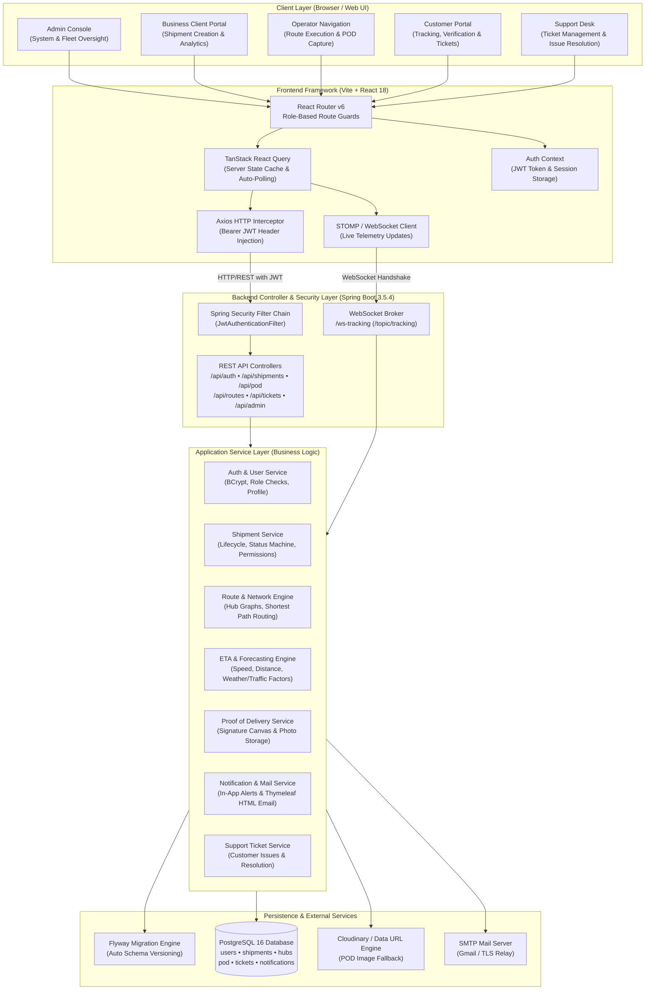
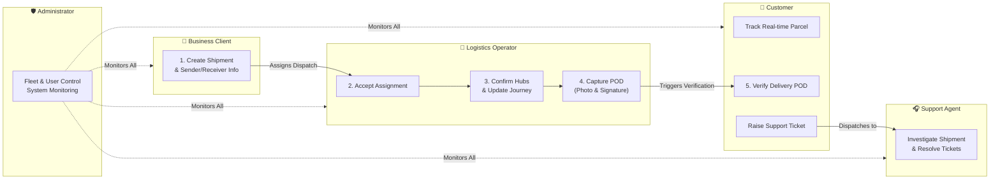
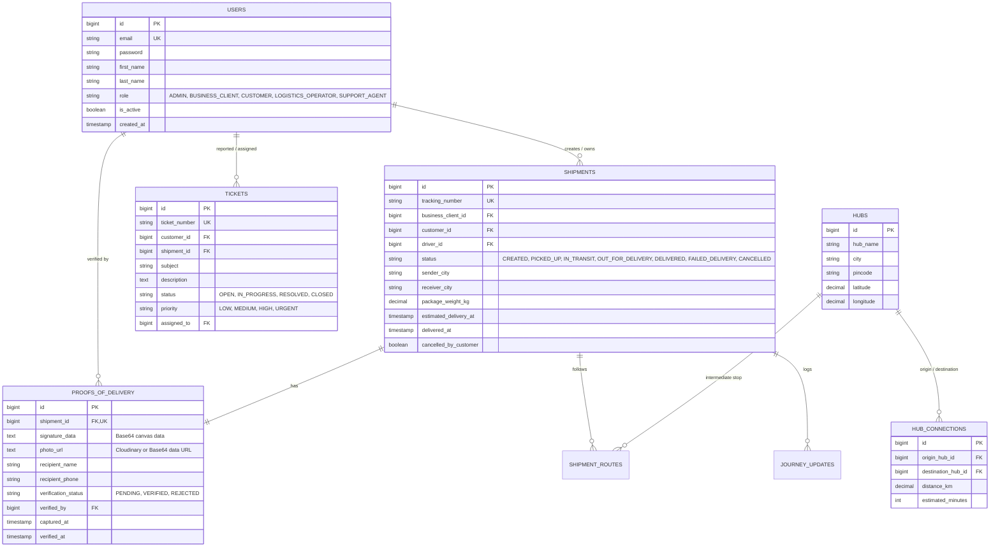

# 🏗️ ShipTrackPro — System Architecture & Design Document

**ShipTrackPro** is an enterprise-grade logistics and parcel tracking platform built on a modern Spring Boot + React stack with PostgreSQL.

---

## 1. High-Level System Architecture Diagram



---

## 2. Multi-Role Interaction & Workflow Architecture

The platform orchestrates 5 distinct actors across the parcel lifecycle:



---

## 3. Delivery Execution & Proof of Delivery (POD) Sequence

This sequence highlights the complete delivery loop, including the Cloudinary/Base64 photo fallback architecture:

```mermaid
sequenceDiagram
    autonumber
    actor Driver as Logistics Operator (Ragu)
    participant UI as Operator Navigation (React)
    participant API as Backend (Spring Boot)
    participant POD as CloudinaryService / Base64 Engine
    participant DB as PostgreSQL (ShiptrackPro)
    participant WS as WebSocket Topic (/topic/tracking)
    actor Customer as Customer (Manju)

    Driver->>UI: Selects "DELIVERED" status
    Driver->>UI: Draws signature + takes delivery photo
    Driver->>UI: Clicks "Complete Delivery"
    UI->>API: POST /api/pod (multipart/form-data: JSON + Photo File)
    activate API

    alt Cloudinary Configured
        API->>POD: uploadImage(photo) via Cloudinary API
        POD-->>API: secure_url (CDN link)
    else Demo Key / Network Offline
        API->>POD: Convert to Base64 Data URL (data:image/jpeg;base64,...)
        POD-->>API: Inline Data URL string
    end

    API->>DB: INSERT INTO proofs_of_delivery (signature_data, photo_url, status='PENDING')
    API->>DB: UPDATE shipments SET status='DELIVERED', delivered_at=NOW()
    API->>WS: Broadcast shipment update to subscribers
    WS-->>Customer: Real-time status update: "Delivered"
    API-->>UI: 200 OK (Delivery Completed)
    deactivate API

    Customer->>API: GET /api/pod/pending
    API-->>Customer: Returns POD with photo & signature
    Customer->>API: PUT /api/pod/{id}/verify
    API->>DB: UPDATE proofs_of_delivery SET verification_status='VERIFIED'
    API-->>Customer: 200 OK (POD Verified)
```

---

## 4. Database Entity-Relationship (ER) Architecture



---

## 5. Technology Stack Summary

| Layer | Technology | Key Responsibility |
| :--- | :--- | :--- |
| **Frontend Framework** | React 18 + Vite | Single Page Application (SPA), lightning fast HMR |
| **Styling & UI Components** | Tailwind CSS + Radix UI | Modern accessible design system with dark/light theme |
| **Client State & Cache** | TanStack React Query v5 | Auto invalidation, refetch intervals, seamless async state |
| **Client Routing** | React Router DOM v6 | Role-based protected routes (`/app/admin`, `/app/operator`, etc.) |
| **Signature Capture** | Signature Pad (Canvas API) | Recipient physical signature vectorization |
| **Backend Framework** | Spring Boot 3.5.4 | Enterprise monolithic REST API & WebSocket server |
| **Language Runtime** | Java 21 LTS | Modern virtual threads, pattern matching, record types |
| **Security & Auth** | Spring Security + JJWT 0.12 | Stateless token-based security, role authorizations |
| **Database ORM** | Spring Data JPA + Hibernate 6 | Relational mapping, pessimistic locking (`PessimisticLock`) |
| **Database Migrations** | Flyway 11 | Version-controlled schema migrations (`db/migration/V*.sql`) |
| **Database** | PostgreSQL 16 | Relational store with ACID transactions and high throughput |
| **Real-time Engine** | Spring STOMP / WebSockets | Live parcel telemetry and GPS coordinates dispatch |
| **Media & Asset Engine** | Cloudinary SDK + Base64 Fallback | Resilient photo uploads that never fail offline |
| **Email Subsystem** | Spring Mail + Thymeleaf | Rich branded HTML transactional parcel emails |
